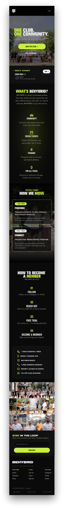
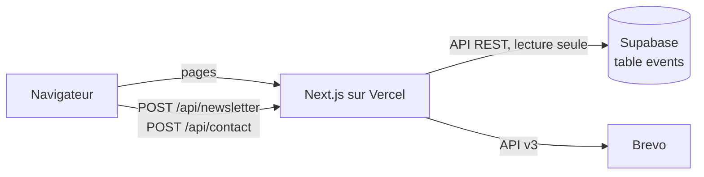

# BEHYBRID Website

Site officiel du **BEHYBRID Run Club Brussels**, un club de course à pied bruxellois.

**En ligne :** [www.behybridrunclub.com](https://www.behybridrunclub.com)

`Next.js 16` · `React 19` · `TypeScript` · `Tailwind CSS 4` · `Supabase` · `Brevo` · `Vercel`

---

## Sommaire

- [Présentation](#présentation)
- [Aperçu](#aperçu)
- [Pages et fonctionnalités](#pages-et-fonctionnalités)
- [Stack technique](#stack-technique)
- [Architecture](#architecture)
- [Design system](#design-system)
- [Structure du projet](#structure-du-projet)
- [Installation](#installation)
- [Déploiement](#déploiement)

---

## Présentation

BEHYBRID est un run club fondé à Bruxelles en 2024. Il propose deux formats de course :

- **Perform** : des séances de performance encadrées par un coach (seuil, fractionné VO₂ max, séances spécifiques à la compétition) ;
- **Connect** : des sorties en groupe à allure facile, pensées pour créer du lien.

Le site est la base digitale du club. Il présente le club et sa philosophie, publie le calendrier des entraînements, permet de s'inscrire à la newsletter et d'écrire au club. Le contenu public est en anglais, les pages légales sont en anglais et en français.

Le projet a été conçu et développé de bout en bout : maquettes, design system, intégration front-end, logique serveur, intégrations tierces et mise en production.

---

## Aperçu

Les maquettes desktop et mobile ont servi de base au développement. Le site en ligne s'en écarte sur certains points.

### Accueil

<p>
  
  
</p>

### Calendrier

<p>
  
  
</p>

### Boutique

La boutique existe à l'état de maquette. Elle n'est pas développée dans le site en ligne.

<p>
  
  
</p>

---

## Pages et fonctionnalités

### Accueil (`/`)

Une suite de sections plein écran :

- **Hero** : photo du club (cadrage portrait sur téléphone, paysage sur ordinateur), bandeau défilant, titre « Perform & Connect », bouton vers la section d'adhésion et bouton vers le calendrier. La carte **Next Run** affiche le prochain entraînement, lu à la même source que la page calendrier, et mène directement à cet entraînement dans la liste.
- **What's BEHYBRID** : présentation du club, chiffres clés et quatre cartes qui s'inclinent en 3D vers le curseur.
- **How We Move** : les deux formats, Perform et Connect, sur une photo d'entraînement, avec un second bandeau défilant.
- **The Crew** : l'équipe du club présentée une personne à la fois, avec défilement automatique, pause au survol et accès direct par prénom.
- **Become A Member** : le parcours d'adhésion en quatre étapes et les avantages réservés aux membres.
- **Galerie** de photos du club.

### Calendrier (`/calendar`)

- **Grille mensuelle** navigable de mois en mois. Les jours d'entraînement sont marqués d'un point. Seuls les entraînements à venir sont cliquables, et mènent à leur ligne dans la liste.
- **Liste « Next Runs »** : uniquement les entraînements à venir, jour même compris. Chaque ligne indique la date, le jour, le titre, l'heure, le lieu et le type de séance (Perform en vert, Connect en gris). La liste se met à jour seule au fil des semaines.
- **Mise en évidence** de l'entraînement visé par l'ancre de l'URL, y compris en arrivant depuis la carte Next Run de l'accueil.
- **Lien vers le club Strava**, où se font les inscriptions aux séances.
- **Fuseau de Bruxelles** : la date du jour est toujours calculée à l'heure de Bruxelles, quel que soit le fuseau du serveur ou du visiteur.

### Contact (`/contact`)

- Canaux de contact (email, Instagram, lieu de rendez-vous).
- Formulaire : prénom, nom, email, sujet (rejoindre le club, partenariat, autre) et message. Le message part par email dans la boîte du club, avec l'adresse du visiteur en adresse de réponse. Rien n'est enregistré en base.

### Newsletter

- Formulaire présent dans le pied de page de toutes les pages.
- Inscription en **double opt-in** via Brevo : le contact n'est ajouté à la liste qu'après avoir cliqué sur le lien de l'email de confirmation.
- Messages distincts selon le cas : confirmation envoyée, adresse déjà inscrite, adresse invalide, erreur.
- Page d'arrivée après confirmation : `/newsletter/confirmed` (non indexée).

### Pages légales

`/legal-notice`, `/privacy` et `/cookie-policy`. Chaque page contient la version anglaise puis la version française, avec un lien d'accès direct au français. Les informations légales du club sont centralisées dans `src/lib/legal.ts`, pour que les trois pages ne puissent pas diverger.

### Pages techniques

- `/style-guide` : page interne qui documente le design system (couleurs, typographie, rayons, composants, animations). Non indexée.
- Pages d'erreur aux couleurs du club : page 404 (`not-found.tsx`), erreur de rendu avec bouton de nouvel essai (`error.tsx`) et erreur du layout racine (`global-error.tsx`).

### Éléments communs

- **Header** collant avec navigation centrée. Sur téléphone, un menu plein écran qui bloque le défilement de la page (méthode fiable sur iOS) et affiche les réseaux sociaux du club.
- **Footer** avec newsletter, colonnes de liens, réseaux sociaux et liens légaux.
- **Écran de chargement** animé (un coureur qui parcourt une barre de progression), joué uniquement au premier chargement du site.
- **Défilement doux** vers les ancres, écrit à la main pour maîtriser sa durée, et interrompu au moindre geste de l'utilisateur.

---

## Stack technique

| Domaine | Choix |
| --- | --- |
| Framework | Next.js 16 (App Router), React 19 |
| Langage | TypeScript en mode strict |
| Style | Tailwind CSS 4, tokens déclarés dans `globals.css` |
| Icônes | lucide-react |
| Données | Supabase (Postgres), lu via son API REST |
| Emails | Brevo (API v3) : newsletter et formulaire de contact |
| Images générées | `next/og` pour le favicon et l'icône iOS |
| Qualité | ESLint 9 avec `eslint-config-next` (Core Web Vitals et TypeScript) |
| Hébergement | Vercel |

Aucun SDK n'est nécessaire pour Supabase ni pour Brevo : les deux services sont appelés avec `fetch`, depuis le serveur.

---

## Architecture



Le navigateur ne parle qu'au serveur du site. Supabase et Brevo ne sont jamais appelés depuis la page, et aucune clé ne quitte le serveur.

### Lecture des événements côté serveur

- `getCalendarEvents()` (`src/lib/calendar-events.ts`) interroge la table `events` via l'API REST de Supabase, avec la clé `anon`, et ne sélectionne que les colonnes utiles, triées par date et heure.
- La fonction est appelée par deux composants serveur : l'accueil (carte Next Run) et la page calendrier. Les deux pages appellent `connection()` et la requête est faite sans cache : un entraînement ajouté dans Supabase apparaît sur le site sans redéploiement.
- Si les variables Supabase sont absentes ou si la requête échoue, le site se replie sur un jeu d'événements local, au lieu de casser la page.
- Le filtrage des entraînements à venir repose sur la date du jour à Bruxelles (`src/lib/club-time.ts`), calculée avec `Intl`. Le résultat est identique sur le serveur et dans le navigateur, ce qui évite les erreurs d'hydratation.
- La grille mensuelle est un composant client qui reçoit les événements en propriétés : aucune requête de données ne part du navigateur.

### Intégration Brevo

**Newsletter** (`/api/newsletter`, `src/lib/brevo.ts`) :

1. validation de l'adresse ;
2. vérification que le contact n'est pas déjà inscrit à la liste ;
3. demande de double opt-in à Brevo, avec la liste, le modèle d'email de confirmation et l'adresse de retour `/newsletter/confirmed` ;
4. Brevo envoie l'email, inscrit le contact après le clic, puis le redirige vers le site.

La preuve du consentement est conservée par Brevo. Le site ne stocke aucune adresse.

**Formulaire de contact** (`/api/contact`, `src/lib/contact.ts`) : validation et normalisation de la saisie, puis envoi d'un email transactionnel au club. Le visiteur reçoit un statut simple (`sent`, `invalid` ou `error`).

### Sécurité

- **Secrets côté serveur uniquement** : les clés Supabase et Brevo ne portent pas le préfixe `NEXT_PUBLIC_` et ne sont lues que dans des modules serveur.
- **Base en lecture seule** : la table `events` a la sécurité au niveau des lignes (RLS) activée, avec une seule politique, en lecture. La clé `anon` ne permet aucune écriture. La base ne contient aucune donnée personnelle.
- **En-têtes HTTP** posés dans `next.config.ts` : politique de contenu (CSP) avec `connect-src 'self'`, `frame-ancestors 'none'`, `form-action 'self'`, `base-uri 'self'` et `object-src 'none'`, plus `X-Frame-Options`, `X-Content-Type-Options`, `Referrer-Policy` et `Permissions-Policy`. En production s'ajoutent `Strict-Transport-Security` et `upgrade-insecure-requests`. La CSP autorise les scripts et styles en ligne, un compromis assumé pour garder les pages pré-générables.
- **Limitation de débit** par adresse IP sur les routes qui envoient un email : 5 requêtes par minute pour la newsletter, 3 pour le contact. Le compteur vit en mémoire, il protège contre un script naïf, pas contre une attaque distribuée.
- **Anti-spam** : un champ piège invisible dans le formulaire de contact. Un robot qui le remplit reçoit une fausse confirmation et rien n'est envoyé.
- **Validation serveur** de toutes les saisies (longueurs maximales, format d'email, sujet parmi une liste fermée) et **échappement HTML** du contenu inséré dans l'email.
- **Aucun cookie**, aucun stockage dans le navigateur, aucune mesure d'audience, aucune police ni ressource chargée depuis un tiers.

### Référencement et partage

- Métadonnées par page, `sitemap.xml` (`src/app/sitemap.ts`) déduit de la navigation active, et `robots.txt` (`src/app/robots.ts`).
- **Indexation fermée par défaut** : tant que `NEXT_PUBLIC_ALLOW_INDEXING` ne vaut pas `true`, toutes les pages portent un `noindex` et le `robots.txt` interdit l'exploration. Une préversion ne peut donc pas être indexée avant le vrai domaine.
- **Données structurées schema.org** : un `SportsClub` pour le club (dans le layout) et un `SportsEvent` par entraînement à venir sur `/calendar`, avec date, lieu, fuseau de Bruxelles et gratuité.
- **Image de partage** statique (`src/app/opengraph-image.jpg`, 1200 × 630). Son code source est conservé dans `scripts/opengraph-image.generator.tsx`, avec la procédure pour la régénérer.
- **Favicon** et **icône d'écran d'accueil iOS** générés par le code à partir du logo (`icon.tsx`, `apple-icon.tsx`).

### Performance et accessibilité

- La photo du hero passe par un élément `<picture>` construit avec `getImageProps` : le navigateur ne télécharge que la version adaptée à l'écran, et le préchargement est conditionné à la largeur.
- Images servies par `next/image`, polices hébergées localement.
- Les révélations au défilement, les bandeaux, l'inclinaison 3D, le défilement doux et la galerie de l'équipe respectent `prefers-reduced-motion`.
- Sans JavaScript, une règle `<noscript>` retire l'écran de chargement et affiche les blocs animés : la page reste lisible.
- Hiérarchie de titres respectée, libellés ARIA sur les contrôles, attribut `lang="fr"` sur les sections françaises des pages légales, contraste des textes secondaires au niveau AA.

---

## Design system

Un univers sombre, un accent vert citron et une typographie affirmée. Les valeurs sont déclarées comme tokens Tailwind dans `src/app/globals.css` et documentées sur la page interne `/style-guide`.

### Couleurs

| Token | Valeur | Usage |
| --- | --- | --- |
| `bg` | `#0a0a0a` | Fond principal |
| `bg-alt` | `#111111` | Fond des panneaux et encarts |
| `ink` | `#f4f4f1` | Texte principal |
| `muted` | `#9c9c96` | Texte secondaire |
| `faint` | `#7e7e79` | Labels et légendes |
| `line` | `rgba(255, 255, 255, 0.08)` | Bordures et séparateurs |
| `accent` | `#c9f133` | Vert de la marque |

### Typographie

- **Archivo** pour tout le site, dans ses neuf graisses (100 à 900).
- **Montserrat Black** réservée à l'esperluette de « Perform & Connect » (utilitaire `font-mont`).
- Les polices sont des fichiers locaux (`public/fonts/`), déclarés en `@font-face`.
- Échelle : `display` 64 px, `h1` 44 px, `h2` 30 px, `h3` 22 px, `body` 15 px, `body-sm` 13 px, `label` 11 px. Les titres de section montent à 70 px sur ordinateur.

### Points de rupture

- **base** : jusqu'à 427 px, téléphones standards.
- **`phone-lg:`** : de 428 à 859 px, variante personnalisée pour les grands téléphones.
- **`md:`** : à partir de 860 px, ordinateur. Ce seuil remplace les 768 px par défaut de Tailwind.

### Composants

- `Button` : variantes `primary`, `secondary`, `ghost`, tailles `sm`, `md`, `lg`. Rendu en lien ou en bouton selon la présence d'un `href`.
- `Badge` : variantes `accent`, `outline`, `white`.
- `Container` : grille commune, alignée sur les marges du header.
- `ScrollButton` et `ScrollCue` : navigation vers une section avec le défilement doux.

### Mouvement

- `Reveal` : révélation au défilement (fondu et glissement de 48 px, courbe `cubic-bezier(0.22, 1, 0.36, 1)`), basée sur `IntersectionObserver`. Sur ordinateur, l'animation se rejoue à chaque retour du bloc à l'écran. Sur téléphone, elle ne se joue qu'une fois, et seulement sur quelques blocs choisis.
- `ReplayOnView` : relance une animation CSS sans déplacer son conteneur, pour préserver le flou d'arrière-plan des cartes.
- `TiltCard` : inclinaison 3D vers le curseur, jusqu'à 8°, avec un reflet vert qui suit la souris. Souris uniquement.
- Bandeaux défilants (`animate-marquee`) en boucle de 30 secondes.

---

## Structure du projet

```text
behybrid-website/
├── docs/images/            # captures utilisées dans ce README
├── public/
│   ├── fonts/              # Archivo et Montserrat
│   ├── icons/              # logos des réseaux sociaux
│   ├── logo/               # logos du club
│   └── photos/             # photos du club et de l'équipe
├── scripts/
│   └── opengraph-image.generator.tsx   # source de l'image de partage
├── supabase/
│   └── events.sql          # table des entraînements
├── src/
│   ├── app/                # routes (App Router)
│   │   ├── api/            # routes serveur : contact, newsletter
│   │   ├── calendar/       # page calendrier
│   │   ├── contact/        # page contact
│   │   ├── legal-notice/   # pages légales
│   │   ├── privacy/
│   │   ├── cookie-policy/
│   │   ├── newsletter/     # page de confirmation d'inscription
│   │   ├── style-guide/    # design system (interne)
│   │   ├── layout.tsx      # layout racine, métadonnées, header et footer
│   │   ├── page.tsx        # accueil
│   │   ├── globals.css     # tokens, polices, animations
│   │   └── …               # sitemap, robots, icônes, pages d'erreur
│   ├── components/
│   │   ├── calendar/       # grille du mois, données structurées
│   │   ├── contact/        # formulaire de contact
│   │   ├── layout/         # header, footer, newsletter, écran de chargement, équipe
│   │   ├── legal/          # gabarit bilingue des pages légales
│   │   └── ui/             # Button, Badge, Container, Reveal, TiltCard…
│   └── lib/                # événements, Brevo, contact, limitation de débit,
│                           # navigation, URL du site, informations légales
├── .env.example            # variables d'environnement à définir
├── next.config.ts          # en-têtes de sécurité
└── package.json
```

---

## Installation

### Prérequis

- **Node.js 20.9** ou plus récent (minimum requis par Next.js 16) et npm.
- Un projet **Supabase**, pour le calendrier. Facultatif en local : sans lui, le site utilise un jeu d'événements de secours.
- Un compte **Brevo**, pour la newsletter et le formulaire de contact. Sans lui, les deux formulaires répondent par une erreur.

### Démarrage

Après avoir cloné le dépôt :

```bash
npm install
cp .env.example .env.local   # puis renseigner les valeurs
npm run dev
```

Le site est alors disponible sur [http://localhost:3000](http://localhost:3000).

### Commandes

```bash
npm run dev     # serveur de développement
npm run build   # build de production
npm run start   # sert le build de production
npm run lint    # analyse du code avec ESLint
```

### Variables d'environnement

Toutes sont listées dans `.env.example`. Les fichiers `.env*` sont ignorés par Git, à l'exception de cet exemple.

| Variable | Rôle |
| --- | --- |
| `SUPABASE_URL` | Adresse du projet Supabase. |
| `SUPABASE_ANON_KEY` | Clé publique `anon` du projet, utilisée côté serveur pour lire la table `events`. |
| `NEXT_PUBLIC_SITE_URL` | Adresse publique du site, sans barre oblique finale. Sert aux URL absolues : métadonnées, plan du site, données structurées, retour après confirmation de la newsletter. À défaut, le site utilise l'adresse de production fournie par Vercel, puis `http://localhost:3000`. |
| `NEXT_PUBLIC_ALLOW_INDEXING` | `true` uniquement en production. Toute autre valeur ferme l'indexation. |
| `BREVO_API_KEY` | Clé d'API Brevo (SMTP et API, onglet Clés d'API). |
| `BREVO_LIST_ID` | Identifiant de la liste qui reçoit les inscrits. |
| `BREVO_DOI_TEMPLATE_ID` | Identifiant du modèle d'email de confirmation double opt-in. |
| `CONTACT_TO_EMAIL` | Destinataire des messages du formulaire de contact. Facultatif : à défaut, l'adresse du club définie dans `src/lib/site.ts`. |
| `BREVO_SENDER_EMAIL` | Expéditeur des emails envoyés par le site. Il doit être vérifié dans Brevo, sinon l'envoi est refusé. |
| `BREVO_SENDER_NAME` | Nom affiché de l'expéditeur. Facultatif. |

### Table Supabase

Le schéma tient dans `supabase/events.sql`. Il suffit de l'exécuter dans l'éditeur SQL du projet Supabase. Le script peut être relancé sans erreur. Il crée :

- un type `event_type` à deux valeurs, `PERFORM` et `CONNECT` ;
- la table `events` : `slug` unique, `event_date`, `start_time`, `duration_minutes` (90 par défaut), `title`, `location`, `event_type`, ainsi que `strava_url` (facultative, non lue par le site), `created_at` et `updated_at` ;
- la sécurité au niveau des lignes, avec une politique de lecture publique ;
- un index sur `event_date` et un déclencheur qui met à jour `updated_at`.

Le site ne fait que lire cette table : les entraînements s'ajoutent directement dans Supabase. Exemple :

```sql
insert into public.events (slug, event_date, start_time, title, location, event_type)
values ('intervals-2026-12-02', '2026-12-02', '19:30', 'Intervals', 'Parc du Cinquantenaire', 'PERFORM');
```

### Configuration Brevo

Côté Brevo, il faut une liste de contacts, un modèle d'email de confirmation double opt-in et une adresse d'expéditeur vérifiée. Leurs identifiants se reportent dans les variables ci-dessus.

---

## Déploiement

Le site est hébergé sur **Vercel**, en production sur [www.behybridrunclub.com](https://www.behybridrunclub.com).

- Les variables d'environnement se définissent dans les réglages du projet Vercel. Les variables `NEXT_PUBLIC_` sont intégrées au moment du build : après un changement, il faut redéployer.
- En production : `NEXT_PUBLIC_SITE_URL` pointe vers le domaine définitif et `NEXT_PUBLIC_ALLOW_INDEXING` vaut `true`. Les préversions gardent l'indexation fermée.
- Les en-têtes de sécurité de `next.config.ts` s'appliquent à toutes les routes. HSTS et `upgrade-insecure-requests` ne sont envoyés qu'en production, pour ne pas gêner le développement local en HTTP.
- L'accueil et le calendrier sont rendus à chaque requête : une modification de la table `events` est visible immédiatement, sans nouveau déploiement.
- Une fois en ligne, les données structurées de `/calendar` peuvent être contrôlées avec le test des résultats enrichis de Google.

---

Antonino Lo Bianco · 2026
