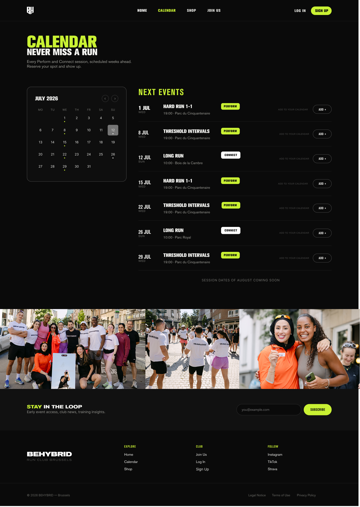
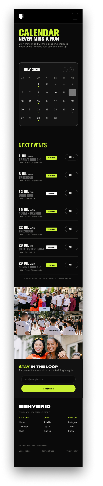

# BEHYBRID Website

> Le site web et la boutique en ligne du **BEHYBRID Run Club Brussels**.
> Une web app complète, du design à la mise en ligne, conçue et développée en solo avec l'IA comme copilote.

**Démo en ligne :** _à venir_ · **Statut :** en développement actif

`Next.js 16` · `React 19` · `TypeScript` · `Tailwind CSS 4` · `Supabase` · `Stripe`

---

## Le club BEHYBRID

BEHYBRID est un run club bruxellois fondé en **juillet 2024** par les frères **Gianluca Lo Bianco** (coach sportif et running) et **Antonino Lo Bianco** (développeur qui apprend à exploiter l'IA de façon concrète et utile, en charge de tout l'écosystème digital du club). Gianluca porte le volet sportif, Antonino la vie du club et sa présence digitale.

Le nom vient de leur pratique : deux athlètes **hybrides**, qui mêlent la course à pied au cardio et à la musculation. BEHYBRID, c'est "être hybride".

Le club propose des **entraînements hebdomadaires** orientés performance individuelle, pour aider chacun à atteindre ses objectifs de course à pied, ainsi que **deux sorties en équipe par mois** (la Team BEHYBRID), à but commercial ou non. On y trouve autant l'esprit de compétition que la convivialité, et le plus souvent les deux se rejoignent : tout le monde se sent à la fois compétitif et bien entouré.

Ses valeurs : **communauté, dépassement de soi, devenir la meilleure version de soi-même**, avec un mindset de guerrier et des gens de qualité.

Aujourd'hui, BEHYBRID rassemble **plus d'une centaine de membres inscrits**, avec 20 à 40 participants par entraînement selon les saisons. Présent sur Instagram et TikTok, le club arrive bientôt sur le web avec ce site.

---

## Les besoins auxquels le site répond

Jusqu'ici, BEHYBRID vivait uniquement sur les réseaux sociaux. Le club avait besoin d'une vraie base digitale pour structurer sa croissance. Le site répond à cinq besoins concrets :

- **Expliquer le club (landing page).** Une porte d'entrée claire qui présente BEHYBRID, sa philosophie et donne envie de rejoindre la communauté.
- **Vendre (boutique en ligne).** Un shop pour proposer les produits du club, avec un paiement en ligne sécurisé.
- **Rassembler autour des événements (calendrier).** Un calendrier des entraînements et des sorties en équipe, pour que chacun sache quand et où courir.
- **Créer un espace membre (authentification).** Bien plus qu'un simple login : un véritable espace communautaire. Le membre s'inscrit aux entraînements et aux sorties, suit sa participation, accède à des avantages réservés (tarifs shop, événements privés), gère ses commandes et son profil. C'est ce qui transforme un site vitrine en plateforme communautaire.
- **Piloter la communauté (gestion des membres).** Une vue d'ensemble sur tous les membres du club, pour accompagner sa montée en puissance et fidéliser une communauté grandissante.

---

## Fonctionnalités

Légende : ✅ en place · 🚧 en cours · ⬜ à venir

### Site public

- ✅ **Landing page** présentant le club, sa philosophie et ses valeurs
- ✅ **Calendrier** des entraînements et sorties
- ✅ **Header, footer et navigation** partagés sur tout le site
- ✅ **Identité visuelle** intégrée (logos, photos, polices Akzidenz Grotesk Pro)
- ✅ **Formulaire newsletter** (interface prête)
- ⬜ **Page "Rejoindre"** (`/join-us`), parcours d'entrée dans la communauté

### Espace membre

- ⬜ **Inscription et connexion** sécurisées
- ⬜ **Profil personnel** éditable
- ⬜ **Inscription aux entraînements et sorties** depuis le calendrier
- ⬜ **Suivi des commandes** et adresses enregistrées
- ⬜ **Avantages membres** (tarifs shop, contenus réservés)

### Boutique

- ⬜ **Catalogue produits**
- ⬜ **Panier et paiement en ligne** sécurisé
- ⬜ **Historique d'achats**

### Espace administrateur

- ⬜ **Vue d'ensemble des membres** du club
- ⬜ **Gestion des événements** du calendrier
- ⬜ **Gestion des produits** de la boutique

---

## Mon rôle

Ce projet est mené **en solo, de bout en bout**, par Antonino Lo Bianco. Il couvre l'ensemble de la chaîne, de l'idée au produit :

- **Conception produit** : traduire les besoins réels du club en fonctionnalités concrètes.
- **Design UI/UX** : conception des maquettes et de l'identité visuelle sur Figma, avant passage au code.
- **Développement front-end** : intégration de l'interface avec Next.js, React, TypeScript et Tailwind CSS.
- **Développement back-end** : base de données, authentification et logique serveur avec Supabase.
- **Paiement et sécurité** : intégration Stripe et architecture pensée pour protéger les données personnelles et bancaires (voir la section sécurité).
- **Déploiement** : mise en ligne et hébergement sur Vercel.

L'objectif : porter un projet réel, utilisé par de vraies personnes, du premier trait de design jusqu'à la mise en production.

---

## La stack et les choix techniques

Chaque outil a été choisi pour une raison précise, avec la sécurité et la fiabilité comme fil conducteur.

| Domaine | Choix | Pourquoi ce choix |
| --- | --- | --- |
| **Framework** | Next.js 16 + React 19 | Rendu serveur pour des pages rapides et un bon référencement, et une logique sensible qui reste côté serveur, jamais exposée au navigateur. |
| **Langage** | TypeScript | Typage strict qui évite une large classe d'erreurs avant même l'exécution. |
| **Style** | Tailwind CSS 4 | Un design system cohérent et rapide à faire évoluer, sans CSS dispersé. |
| **Base de données + Auth** | Supabase | Une base Postgres managée avec authentification intégrée et sécurité au niveau des lignes (RLS), sans serveur à administrer soi-même. |
| **Paiement** | Stripe | Standard de l'industrie, certifié PCI. Les données bancaires ne transitent jamais par notre serveur. |
| **Hébergement** | Vercel | Déploiement continu, HTTPS automatique et secrets chiffrés. |

**Le principe directeur : déléguer la sécurité aux spécialistes.** Plutôt que de réinventer l'authentification, le paiement ou l'infrastructure, le projet s'appuie sur des acteurs éprouvés (Supabase, Stripe, Vercel) et concentre l'effort sur l'expérience et la logique métier. Un choix à la fois plus sûr et plus réaliste pour livrer un produit fiable.

---

## Du web design au développement

Ce projet suit une démarche design-first : penser l'expérience et l'identité visuelle avant d'écrire la première ligne de code. Un univers sombre, un accent vert signature, une typographie affirmée (Akzidenz Grotesk Pro) et une direction artistique forte, cohérente sur tout le site.

### Les maquettes (Figma)

Les écrans ont d'abord été conçus sur Figma, en versions desktop et mobile, pour une expérience pensée responsive dès le départ.

#### Page d'accueil

  
  

#### Page boutique

  
  

#### Page calendrier

  
  

### Le design system

Base visuelle cohérente extraite des maquettes (couleurs, typographie, composants) pour garantir l'homogénéité de toutes les pages.

_[Aperçu du design system à venir]_

### Le site en ligne

Traduction fidèle des maquettes en interface réelle avec Next.js et Tailwind CSS, du design statique au produit déployé et interactif.

_[Captures du site déployé à venir]_

---

## Construit avec l'IA

Ce projet est développé main dans la main avec l'IA, avec deux outils Anthropic complémentaires : **Claude Code** pour toute la partie développement (code, architecture, logique) et **Claude Design** pour explorer des directions visuelles et concevoir le design system. L'IA n'est pas un gadget ici, c'est une méthode de travail à part entière.

Concrètement, l'IA intervient pour :

- **Accélérer le développement** : générer, relire et affiner le code avec Claude Code, tout en gardant la main sur l'architecture et les décisions.
- **Explorer le design** : obtenir des idées et une première direction visuelle avec Claude Design, puis créer les maquettes moi-même sur Figma à partir de cette base. Claude Design a ensuite aidé à concevoir le design system.
- **Renforcer la sécurité** : passer en revue le code sensible (authentification, paiement, données personnelles) avant chaque mise en production.
- **Structurer la réflexion** : cadrer les besoins, comparer les choix techniques, documenter le projet.
- **Apprendre plus vite** : comprendre en profondeur ce que je construis, plutôt que copier sans saisir.

**Ma conviction :** l'IA ne remplace pas le développeur, elle démultiplie celui qui sait s'en servir avec discernement. Ce projet est autant un site pour BEHYBRID qu'une démonstration concrète de cette approche : construire des produits réels, fiables et sécurisés, en intégrant l'IA intelligemment à chaque étape.

Cette démarche s'inscrit dans un objectif plus large : développer une expertise en intégration de l'IA et, à terme, en faire une activité de services (freelance ou agence) au service de projets concrets.

---

## Défis et apprentissages

Construire une web app complète en solo apporte son lot de défis concrets. Quelques-uns rencontrés sur ce projet :

- **Sécuriser des paiements et des données réelles.** Concevoir une architecture où les données bancaires ne transitent jamais par le serveur, et où chaque utilisateur ne peut accéder qu'à ses propres données. Cela a demandé de comprendre la logique de délégation à Stripe et la sécurité au niveau des lignes (RLS) de Supabase.
- **Travailler avec une version récente de Next.js.** Next.js 16 introduit des changements par rapport aux versions plus documentées. Il a fallu lire la documentation à jour plutôt que se fier aux réflexes habituels.
- **Piloter l'IA sans la subir.** Apprendre à faire produire du code de qualité par l'IA tout en gardant le contrôle : vérifier, corriger, comprendre, et ne jamais déployer sans relecture, surtout sur le code sensible.
- **Penser produit, pas seulement code.** Traduire les besoins réels d'un club et de ses membres en fonctionnalités cohérentes, en gardant l'utilisateur final au centre.

Chaque étape est autant un livrable qu'un apprentissage, dans une montée en compétence continue vers l'expertise en développement et en intégration de l'IA.

---

## Avancement du projet

> Section mise à jour à chaque session de travail. Reflète l'état réel du projet et le point exact où l'on s'est arrêté.

**Dernière mise à jour : 2026-07-31**

### Où on en est

Le socle public est en place : page d'accueil, calendrier et style guide fonctionnels, avec l'identité visuelle intégrée et un build de production qui passe. Les maquettes Figma des écrans clés (accueil, boutique, calendrier) sont finalisées en desktop et mobile.

### Prochaine étape

Construire le design system à partir des maquettes, puis attaquer la page `/join-us`, principal parcours de conversion depuis l'accueil.

### Reste à faire (vue d'ensemble)

- Design system (en cours)
- Revoir la page d'accueil et le calendrier, et les modifier si nécessaire
- Page `/join-us`
- Authentification et espace membre (Supabase)
- Boutique et paiement (Stripe)
- Espace administrateur (gestion membres, événements, produits)
- Pages légales (`/privacy`, `/legal-notice`, `/terms`)
- Déploiement (Vercel)
- Version anglaise du README

### Journal des sessions

**2026-07-31**

- Refonte complète du README en document vitrine et journal de bord vivant.
- Rédaction du document de sécurité `docs/SECURITE.md` (stack Supabase + Stripe + Vercel, RLS, RGPD, checklist).
- Intégration des maquettes Figma (accueil, boutique, calendrier, desktop + mobile).
- Définition de la démarche : design-first, construit avec Claude Code et Claude Design.
