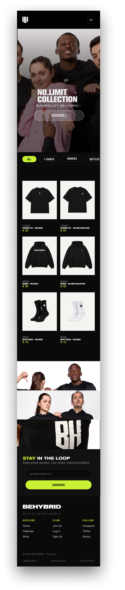

# BEHYBRID Website

> Le site web et la boutique en ligne du **BEHYBRID Run Club Brussels**.
> Une web app complète, du design à la mise en ligne, conçue et développée en solo avec l'IA comme copilote.

**Démo en ligne :** _à venir_ · **Statut :** en développement actif

`Next.js 16` · `React 19` · `TypeScript` · `Tailwind CSS 4` · `Supabase` · `Stripe`

---

## Le club BEHYBRID

BEHYBRID est un run club bruxellois fondé en **juillet 2024** par les frères **Gianluca Lo Bianco** (coach sportif et running) et **Antonino Lo Bianco** (développeur qui apprend à exploiter l'IA de façon concrète et utile, en charge de tout l'écosystème digital du club). Gianluca porte le volet sportif, Antonino la vie du club et sa présence digitale.

Le nom vient de leur pratique : deux athlètes **hybrides**, qui mêlent la course à pied au cardio et à la musculation. BEHYBRID, c'est "être hybride".

Le club propose des **entraînements hebdomadaires** orientés performance individuelle, pour aider chacun à atteindre ses objectifs de course à pied, ainsi que **deux sorties en équipe par mois** (la Team BEHYBRID), à but commercial ou non. On y trouve autant l'esprit de compétition que la convivialité, et le plus souvent les deux se rejoignent : tout le monde se sent à la fois compétitif et bien entouré.

Ses valeurs : **communauté, dépassement de soi, devenir la meilleure version de soi-même**, avec un mindset de guerrier et des gens de qualité.

Aujourd'hui, BEHYBRID rassemble **plus d'une centaine de membres inscrits**, avec 20 à 40 participants par entraînement selon les saisons. Présent sur Instagram et TikTok, le club arrive bientôt sur le web avec ce site.

---

## Les besoins auxquels le site répond

Jusqu'ici, BEHYBRID vivait uniquement sur les réseaux sociaux. Le club avait besoin d'une vraie base digitale pour structurer sa croissance. Le site répond à cinq besoins concrets :

- **Expliquer le club (landing page).** Une porte d'entrée claire qui présente BEHYBRID, sa philosophie et donne envie de rejoindre la communauté.
- **Vendre (boutique en ligne).** Un shop pour proposer les produits du club, avec un paiement en ligne sécurisé.
- **Rassembler autour des événements (calendrier).** Un calendrier des entraînements et des sorties en équipe, pour que chacun sache quand et où courir.
- **Créer un espace membre (authentification).** Bien plus qu'un simple login : un véritable espace communautaire. Le membre s'inscrit aux entraînements et aux sorties, suit sa participation, accède à des avantages réservés (tarifs shop, événements privés), gère ses commandes et son profil. C'est ce qui transforme un site vitrine en plateforme communautaire.
- **Piloter la communauté (gestion des membres).** Une vue d'ensemble sur tous les membres du club, pour accompagner sa montée en puissance et fidéliser une communauté grandissante.

---

## Fonctionnalités

Légende : ✅ en place · 🚧 en cours · ⬜ à venir

### Site public

- ✅ **Landing page** présentant le club, sa philosophie et ses valeurs
- ✅ **Calendrier** des entraînements et sorties (données réelles, lecture Supabase, liens Strava)
- ✅ **Header, footer et navigation** partagés sur tout le site
- ✅ **Identité visuelle** intégrée (logos, photos, polices Archivo + Montserrat)
- ✅ **Design system documenté** sur la page interne `/style-guide`
- ✅ **Formulaire newsletter** (interface prête, mais n'enregistre encore rien)
- 🚧 **Page contact** (`/contact`), squelette en place, formulaire à écrire
- 🚧 **Pages légales** (`/legal-notice`, `/privacy`, `/cookie-policy`), créées, contenu à écrire
- ⬜ **Page "Rejoindre"** (`/join-us`), parcours d'entrée dans la communauté

### Espace membre

- ⬜ **Inscription et connexion** sécurisées
- ⬜ **Profil personnel** éditable
- ⬜ **Inscription aux entraînements et sorties** depuis le calendrier
- ⬜ **Suivi des commandes** et adresses enregistrées
- ⬜ **Avantages membres** (tarifs shop, contenus réservés)

### Boutique

- ⬜ **Catalogue produits**
- ⬜ **Panier et paiement en ligne** sécurisé
- ⬜ **Historique d'achats**

### Espace administrateur

- ⬜ **Vue d'ensemble des membres** du club
- ⬜ **Gestion des événements** du calendrier
- ⬜ **Gestion des produits** de la boutique

---

## Mon rôle

Ce projet est mené **en solo, de bout en bout**, par Antonino Lo Bianco. Il couvre l'ensemble de la chaîne, de l'idée au produit :

- **Conception produit** : traduire les besoins réels du club en fonctionnalités concrètes.
- **Design UI/UX** : conception des maquettes et de l'identité visuelle sur Figma, avant passage au code.
- **Développement front-end** : intégration de l'interface avec Next.js, React, TypeScript et Tailwind CSS.
- **Développement back-end** : base de données, authentification et logique serveur avec Supabase.
- **Paiement et sécurité** : intégration Stripe et architecture pensée pour protéger les données personnelles et bancaires (voir la section sécurité).
- **Déploiement** : mise en ligne et hébergement sur Vercel.

L'objectif : porter un projet réel, utilisé par de vraies personnes, du premier trait de design jusqu'à la mise en production.

---

## La stack et les choix techniques

Chaque outil a été choisi pour une raison précise, avec la sécurité et la fiabilité comme fil conducteur.

| Domaine | Choix | Pourquoi ce choix |
| --- | --- | --- |
| **Framework** | Next.js 16 + React 19 | Rendu serveur pour des pages rapides et un bon référencement, et une logique sensible qui reste côté serveur, jamais exposée au navigateur. |
| **Langage** | TypeScript | Typage strict qui évite une large classe d'erreurs avant même l'exécution. |
| **Style** | Tailwind CSS 4 | Un design system cohérent et rapide à faire évoluer, sans CSS dispersé. |
| **Base de données + Auth** | Supabase | Une base Postgres managée avec authentification intégrée et sécurité au niveau des lignes (RLS), sans serveur à administrer soi-même. |
| **Paiement** | Stripe | Standard de l'industrie, certifié PCI. Les données bancaires ne transitent jamais par notre serveur. |
| **Hébergement** | Vercel | Déploiement continu, HTTPS automatique et secrets chiffrés. |

**Le principe directeur : déléguer la sécurité aux spécialistes.** Plutôt que de réinventer l'authentification, le paiement ou l'infrastructure, le projet s'appuie sur des acteurs éprouvés (Supabase, Stripe, Vercel) et concentre l'effort sur l'expérience et la logique métier. Un choix à la fois plus sûr et plus réaliste pour livrer un produit fiable.

---

## Du web design au développement

Ce projet suit une démarche design-first : penser l'expérience et l'identité visuelle avant d'écrire la première ligne de code. Un univers sombre, un accent vert signature, une typographie affirmée (Archivo, avec Montserrat Black en accent sur certains signes) et une direction artistique forte, cohérente sur tout le site.

### Les maquettes (Figma)

Les écrans ont d'abord été conçus sur Figma, en versions desktop et mobile, pour une expérience pensée responsive dès le départ.

#### Page d'accueil

  
  

#### Page boutique

  
  

#### Page calendrier

  
  

### Le design system

Base visuelle cohérente extraite des maquettes, formalisée en tokens dans le code (couleurs, typographie, rayons) et en composants réutilisables (`Button`, `Badge`), pour garantir l'homogénéité de toutes les pages. Documentée sur la page interne `/style-guide`.

### Le site en ligne

Traduction fidèle des maquettes en interface réelle avec Next.js et Tailwind CSS, du design statique au produit déployé et interactif.

_[Captures du site déployé à venir]_

---

## Construit avec l'IA

Ce projet est développé main dans la main avec l'IA, avec deux outils Anthropic complémentaires : **Claude Code** pour toute la partie développement (code, architecture, logique) et **Claude Design** pour explorer des directions visuelles et concevoir le design system. L'IA n'est pas un gadget ici, c'est une méthode de travail à part entière.

Concrètement, l'IA intervient pour :

- **Accélérer le développement** : générer, relire et affiner le code avec Claude Code, tout en gardant la main sur l'architecture et les décisions.
- **Explorer le design** : obtenir des idées et une première direction visuelle avec Claude Design, puis créer les maquettes moi-même sur Figma à partir de cette base. Claude Design a ensuite aidé à concevoir le design system.
- **Renforcer la sécurité** : passer en revue le code sensible (authentification, paiement, données personnelles) avant chaque mise en production.
- **Structurer la réflexion** : cadrer les besoins, comparer les choix techniques, documenter le projet.
- **Apprendre plus vite** : comprendre en profondeur ce que je construis, plutôt que copier sans saisir.

**Ma conviction :** l'IA ne remplace pas le développeur, elle démultiplie celui qui sait s'en servir avec discernement. Ce projet est autant un site pour BEHYBRID qu'une démonstration concrète de cette approche : construire des produits réels, fiables et sécurisés, en intégrant l'IA intelligemment à chaque étape.

Cette démarche s'inscrit dans un objectif plus large : développer une expertise en intégration de l'IA et, à terme, en faire une activité de services (freelance ou agence) au service de projets concrets.

---

## Défis et apprentissages

Construire une web app complète en solo apporte son lot de défis concrets. Quelques-uns rencontrés sur ce projet :

- **Sécuriser des paiements et des données réelles.** Concevoir une architecture où les données bancaires ne transitent jamais par le serveur, et où chaque utilisateur ne peut accéder qu'à ses propres données. Cela a demandé de comprendre la logique de délégation à Stripe et la sécurité au niveau des lignes (RLS) de Supabase.
- **Travailler avec une version récente de Next.js.** Next.js 16 introduit des changements par rapport aux versions plus documentées. Il a fallu lire la documentation à jour plutôt que se fier aux réflexes habituels.
- **Piloter l'IA sans la subir.** Apprendre à faire produire du code de qualité par l'IA tout en gardant le contrôle : vérifier, corriger, comprendre, et ne jamais déployer sans relecture, surtout sur le code sensible.
- **Penser produit, pas seulement code.** Traduire les besoins réels d'un club et de ses membres en fonctionnalités cohérentes, en gardant l'utilisateur final au centre.

Chaque étape est autant un livrable qu'un apprentissage, dans une montée en compétence continue vers l'expertise en développement et en intégration de l'IA.

---

## Avancement du projet

> Section mise à jour à chaque session de travail. Reflète l'état réel du projet et le point exact où l'on s'est arrêté.

**Dernière mise à jour : 2026-08-29**

### Où on en est

Le socle public est en place : page d'accueil, calendrier et style guide fonctionnels, avec un build de production qui passe. Grosse passe de direction artistique : toute la typographie du site est passée à **Archivo** (9 poids) avec **Montserrat Black** en accent, en remplacement d'Akzidenz Grotesk Pro. Le hero de l'accueil a été entièrement repensé (bandeau défilant, titre "PERFORM & CONNECT", carte "NEXT RUN", hauteur plein écran) et enrichi d'animations : écran de chargement "running" (coureur + barre de progression), entrées décalées des blocs, indicateur de scroll, et léger zoom du logo au survol. Les maquettes Figma des écrans clés (accueil, boutique, calendrier) sont finalisées en desktop et mobile.

**La page d'accueil est terminée, en desktop comme en mobile**, section "The Crew" comprise. Les quatre sections plein écran (hero, What's BEHYBRID, How We Move, Become A Member), la galerie et le pied de page sont finalisés et ne bougeront plus. Le parcours interne est cohérent : le bouton "Join The Club" ancre vers la section d'inscription, la carte "Next Run" lit le premier entraînement à venir depuis la même source que `/calendar` et mène au run correspondant, le logo et les liens du menu ramènent en haut, et tous les déplacements verticaux partagent le même défilement doux de 1,6 seconde.

La section **"Become A Member"** est refondue en desktop : en-tête de section, titre à 70px, sous-titre en une ligne, les quatre étapes sur une rangée séparées par des flèches vertes, et un panneau "What You Get" centré, en 3D, avec sa pastille à cheval sur la bordure et les six avantages en trois colonnes. Son mobile reste à faire.

La section **"How We Move"** est terminée en desktop et en mobile : photo plein cadre assombrie et trame technique, titre à 70px, sous-titre, deux cartes floutées avec badge, numéro d'index et pastilles, et un bandeau défilant collé au bord bas. Les trois titres de l'accueil partagent désormais la même taille (70px en desktop). Les révélations au scroll se rejouent à chaque retour à l'écran, sur toutes les sections, hero compris.

La section **"What's BEHYBRID"** est désormais terminée en desktop et en mobile. Refondue d'après les maquettes Figma, elle occupe toute la hauteur de l'écran : barre d'en-tête de section ("About The Club" / "Est. 2024"), grand titre, paragraphe, trois chiffres clés (300+ runners, Every week, Since 2024) et quatre cartes numérotées remplaçant l'ancien bloc d'icônes. Deux halos verts diffus animent le fond. Les cartes, ainsi que la carte "Next Run" du hero, s'inclinent en 3D vers le curseur avec un reflet vert qui le suit. Toutes les colonnes se révèlent au scroll, la gauche par la gauche et les cartes par la droite en cascade.

Le **hero mobile** est finalisé : contenu centré, titre agrandi, et tout le bloc (jusqu'à la carte "Next Run" condensée) tient dans un seul écran sans scroll (`svh` pour éviter le zoom au scroll). Le **menu hamburger mobile** est retravaillé : deux zones distinctes (navigation publique en haut, compte en bas), tailles harmonisées, fond noir plein, et blocage du scroll de la page quand il est ouvert. Corrections mobile : accès au serveur de dev depuis un vrai iPhone (`allowedDevOrigins`) et désactivation de la détection auto iOS des dates/heures (`formatDetection`) qui cassait l'hydratation.

**La page `/calendar` est terminée**, desktop et mobile, et a passé une revue complète le 29/08. Elle lit Supabase côté serveur quand `SUPABASE_URL` et `SUPABASE_ANON_KEY` sont configurés, avec repli sur un jeu local. Le premier import a été préparé à partir du fichier Excel d'Antonino : schéma SQL, CSV propre et guide dans `docs/SUPABASE_EVENTS.md`.

Elle est **autonome dans le temps** : la liste ne montre que les entraînements à venir, la carte "Next Run" de l'accueil lit la même source, et le calendrier mensuel reste navigable sur les mois passés sans que leurs journées soient cliquables. Remplir la base suffit, le site suit. Chaque séance affiche son type (Perform en vert, Connect en gris) et le logo Strava quand `stravaUrl` est renseigné, ou **Strava soon** tant que l'event officiel n'existe pas.

La revue du 29/08 a produit cinq correctifs, dont trois bugs réels : le décalage en cascade des révélations n'est plus proportionnel au nombre d'événements (une saison complète aurait laissé le dernier run invisible sept secondes), les ancres sont construites sur le `slug` et non sur la date affichée (`28 OCT` ne distingue ni deux années ni deux séances d'un même jour), et la date du jour est calculée dans le fuseau de Bruxelles des deux côtés, ce qui supprime un écart d'hydratation mensuel et un run qui disparaissait de la liste à 2h du matin. S'y ajoutent une hiérarchie de titres correcte (`h1` / `h2` / `h3`, la page n'avait qu'un `h1`) et des données structurées `SportsEvent` pour Google.

### Prochaine étape

Dans cet ordre, décidé le 28/08 :

1. **Brancher le formulaire newsletter sur Brevo.** Aujourd'hui il affiche une confirmation sans rien enregistrer, ce qui revient à mentir au visiteur. Créer ou utiliser la liste Brevo, appeler son API (clé en variable d'environnement, jamais en dur), et gérer les cas d'erreur : email déjà inscrit, échec réseau.
2. **Écrire la page `/contact`.** Le squelette existe (en-tête, titre, les trois liens sociaux), il manque le formulaire et son traitement.
3. **Écrire les trois pages légales** : `/legal-notice`, `/privacy`, `/cookie-policy`. Les pages existent et partagent le gabarit `LegalPage`, il n'y a que le contenu à insérer.

**Puis** : la page `/join-us`, la boutique, l'espace membre. Leurs liens sont déjà en place dans `src/lib/nav-links.ts`, désactivés par `enabled: false`.

### Décision durable : inscriptions Strava

Ne pas remettre un bouton d'ajout calendrier `.ics` comme action principale des événements. Le frère d'Antonino crée déjà les events Strava 1 à 2 jours avant chaque séance pour compter les inscriptions et centraliser les participants.

La bonne stratégie est donc :

- garder les entraînements visibles à l'avance sur le site ;
- ajouter un champ `stravaUrl` aux événements ;
- afficher **Strava soon** tant que l'event Strava officiel n'existe pas ;
- afficher **Join** dès que `stravaUrl` est renseigné ;
- plus tard, avec Supabase, ajouter une colonne `strava_url` pour activer le bouton sans modifier le code ni redéployer.

Workflow mensuel recommandé avec Gianluca :

1. Créer les 4 events Strava du mois à l'avance, idéalement en une seule session.
2. Récupérer les 4 URLs Strava officielles.
3. Les associer aux 4 entraînements correspondants du site.
4. Vérifier que les 4 boutons **Join** sont visibles sur `/calendar`.
5. Laisser Strava gérer les inscriptions, le nombre de participants et les notifications.

Cette décision doit rester dans le README jusqu'au branchement réel de Supabase/Strava.

### Checklist de déploiement

> À relire intégralement lors de la revue qui précède la mise en ligne. Chaque
> ligne est une chose qui **ne peut pas** être faite avant de connaître le
> domaine de production, et qui casse silencieusement si on l'oublie : rien
> n'échouera au build, le site aura juste l'air de fonctionner.

**1. Définir `NEXT_PUBLIC_SITE_URL` sur l'hébergeur.**
Le vrai domaine, sans barre oblique finale, par exemple `https://www.behybrid.run`.
Tant qu'elle est absente, le code retombe sur `http://localhost:3000`. Conséquence :
les données structurées de `/calendar` (les `SportsEvent` lus par Google) pointent
vers une machine locale et **Google les ignore purement et simplement**. La variable
sert aussi de `metadataBase`, donc les futures images de partage seraient également
cassées. Voir `src/lib/site.ts`.

**2. Vérifier les données structurées une fois en ligne.**
Coller l'URL de `/calendar` dans le test des résultats enrichis de Google
(`search.google.com/test/rich-results`). On doit y voir un événement par
entraînement à venir, avec date, lieu et prix à 0 €. Ce test est impossible en
local, la page devant être publiquement accessible.

**3. Reporter les variables Supabase.**
`SUPABASE_URL` et `SUPABASE_ANON_KEY` ne sont que dans `.env.local`, qui n'est pas
versionné. Sans elles en production, le site sert le jeu d'événements de secours
codé en dur dans `src/lib/calendar-events.ts`, donc un calendrier figé et faux.

**4. Ce qui n'est pas encore écrit et qui devra l'être.**
Image de partage (`openGraph`), `sitemap.xml` et `robots.txt`. `metadataBase` étant
en place, les trois sont rapides, mais aucun n'existe aujourd'hui : un lien du site
partagé sur WhatsApp ou Instagram n'affiche aucune vignette.

**5. Vérifier que les liens désactivés le sont toujours.**
`src/lib/nav-links.ts` masque boutique, espace membre et `/join-us` via `enabled:
false`. Confirmer qu'aucun n'a été réactivé par inadvertance.

### Reste à faire (vue d'ensemble)

- Contenu des trois pages légales et formulaire de `/contact`
- Référencement : image de partage `openGraph`, `sitemap.xml`, `robots.txt`
- Page `/join-us`
- Authentification et espace membre (Supabase)
- Boutique et paiement (Stripe)
- Espace administrateur (gestion membres, événements, produits)
- Déploiement (Vercel)
- Version anglaise du README

### Journal des sessions

**2026-08-29**

- **Revue complète de la page `/calendar`**, menée avant d'attaquer la newsletter. Cinq points relevés, tous corrigés le jour même.
- **Cascade des révélations plafonnée** : chaque ligne d'événement déclenche sa propre animation en entrant dans l'écran, et son délai était proportionnel à son rang (`300 + index * 140`). Avec onze runs le dernier attendait 1,7 seconde, mais avec une saison complète en base il serait resté invisible sept secondes après être apparu. Le délai s'arrête maintenant au cinquième événement, à 860 ms.
- **Ancres construites sur le `slug`** et non sur la date affichée. `event-28-oct` ne distinguait ni deux années ni deux séances d'une même journée, ce qui aurait produit des `id` en double dans le DOM. L'hypothèse « un entraînement par jour » reste posée dans la grille du mois, mais elle est désormais écrite en commentaire et sa violation dégrade proprement au lieu de casser.
- **Fuseau du club fixé à `Europe/Brussels`**, via `getClubToday()`. La date du jour était lue avec les méthodes de `Date`, qui répondent dans le fuseau de la machine : le serveur Vercel en temps universel et le navigateur bruxellois pouvaient donc afficher deux mois différents, une fois par mois entre minuit et 2h, provoquant un écart d'hydratation React. Le même bug faisait disparaître un run du matin dès 2h du matin la veille. La comparaison se fait maintenant entre dates ISO sous forme de texte, où aucun fuseau ne peut s'inviter.
- **Hiérarchie de titres** : la page n'avait qu'un `h1` suivi de onze titres d'entraînement en `
`. Le mois et « Next Runs » passent en `h2`, les séances en `h3`, la flèche décorative en `aria-hidden`.
- **Données structurées `SportsEvent`** ajoutées (`src/components/calendar/events-json-ld.tsx`) : nom, début et fin, lieu, organisateur, lien Strava en `offers` et prix à 0 € (sans prix déclaré, Google n'affiche pas de résultat enrichi). Le décalage horaire est calculé par `Intl` et bascule donc tout seul à l'heure d'hiver, vérifié sur le run du 28 octobre 2026.
- **`metadataBase` et `NEXT_PUBLIC_SITE_URL`** introduits (`src/lib/site.ts`), avec repli local en développement. D'où la nouvelle **checklist de déploiement** plus haut dans ce README.
- **Métadonnées de `/calendar`** ajoutées : la page héritait du titre de l'accueil et ressortait donc sous le même nom dans Google.
- **Textes** : l'introduction promettait « Reserve your spot » alors qu'aucune réservation n'existe sur la page, remplacée par « The next Perform and Connect runs. Join the event on Strava. ». Sur l'accueil, « For All Levels » est retiré de la carte Next Run en mobile uniquement.
- **Nettoyage** : suppression de l'export mort `EVENTS`.
- **Pied du menu hamburger mobile** : le panneau n'était que trois liens flottant dans un écran noir vide, alors que le pied de page qui porte les liens sociaux est à quatre écrans de défilement. Ajout des trois logos Instagram, TikTok et Strava, d'une ligne `© 2026 BEHYBRID — Brussels` et d'un halo vert centré repris du langage des sections de l'accueil. Rien de tout cela n'existe en desktop, le panneau étant déjà en `md:hidden`.
- **Tailles par logo, pas taille commune** : les fichiers d'icônes ne sont pas construits pareil. Instagram et TikTok sont des tuiles carrées avec 12px de marge transparente intégrée, Strava est un chevron qui occupe toute la hauteur de son canevas. À taille de boîte égale, le chevron écrasait les deux autres, d'où 44px pour les tuiles contre 28px pour le chevron.
- **Piège du cache CSS en développement, diagnostiqué** : sur iPhone, le chevron Strava débordait de sa pastille alors que le CSS compilé était correct. Cause réelle : Turbopack ne change pas le nom du fichier CSS quand son contenu change, Safari servait donc une feuille en cache. Les classes déjà utilisées ailleurs dans le site s'y trouvaient et s'affichaient bien ; les deux classes créées pour l'occasion en étaient absentes, laissant l'image sans contrainte de taille. Conclusion retenue : sur du travail mobile testé sur un vrai appareil, préférer des classes déjà présentes dans le site, et forcer le rechargement avant de conclure à un bug de mise en page.

**2026-08-28**

- **La page `/calendar` est considérée comme faite.** Entraînements réels de Gianluca (septembre-octobre 2026) en place, calendrier mensuel navigable, lecture Supabase active, liens Strava fonctionnels, révélations au scroll. On y reviendra plus tard si besoin : reste ouverte la question de filtrer la liste "Next Events" selon le mois affiché.
- **Menu mobile corrigé** : `overflow: hidden` sur le body est ignoré par iOS Safari, et cassait au passage l'ancrage `sticky` du header, ce qui envoyait le logo et la croix hors écran dès qu'on avait scrollé. Le body est désormais figé en `position: fixed` à la position courante, restaurée à la fermeture, et le header passe en `fixed` pendant l'ouverture.
- **Mise en évidence d'un événement revue** : plus aucun fond ni surlignement, seules les couleurs de texte passent au vert. Le bouton Strava garde sa couleur de marque en permanence.
- **Deux bugs de fond identifiés en inspectant le CSS réellement compilé**, après deux hypothèses erronées de ma part :
  - `border-[#FC4C02]` n'était jamais générée par Tailwind v4 : cette écriture est ambiguë entre largeur et couleur de bordure, donc rien n'était émis et la bordure retombait sur `currentColor`, c'est-à-dire blanc. La forme correcte est `border-[color:#FC4C02]`.
  - Le sélecteur CSS `:target` n'est pas réévalué lors d'une navigation Next.js entre deux pages, qui passe par l'API History. Arriver depuis la carte "Next Run" de l'accueil ne déclenchait donc jamais la mise en évidence. Nouveau composant `EventHighlight` qui pose la classe lui-même.

- **Page Calendar animée** : ajout des révélations au scroll sur l'en-tête, la grille du mois, la galerie et la liste "Next Events". Les événements apparaissent désormais un par un avec un léger décalage, date après date.
- **Calendrier mensuel interactif** : la grille écrite en dur a été remplacée par un composant client `MonthCalendar`. Il démarre sur le vrai mois actuel, surligne le jour d'aujourd'hui, les flèches précédent/suivant naviguent entre les mois et les années, les points verts se recalculent à partir des dates des événements, et les jours avec event sont cliquables pour descendre vers la séance correspondante.
- **Dates desktop harmonisées** : les dates de la liste "Next Events" se lisent maintenant sur deux lignes en desktop (`7` puis `OCT`, comme `11` puis `OCT`) pour garder une colonne régulière.
- **Lien Strava pour les inscriptions** : abandon de l'ajout calendrier direct du site. La liste Calendar affiche désormais une action **Join** quand un `stravaUrl` est renseigné, et **Strava soon** quand le frère d'Antonino n'a pas encore créé l'event Strava.
- **Données d'événements isolées** : les événements ont été déplacés dans `src/lib/calendar-events.ts` pour préparer plus proprement le futur branchement Supabase et recevoir les URLs Strava au fil de l'eau.
- **Ajustement contenu et UI** : la statistique "What's BEHYBRID" passe à `300+ Runners` après confirmation des 321 membres Strava, et les logos Strava sont retirés de la liste Calendar.
- **Préparation Supabase Events** : analyse de `data/import/behybrid-events.xlsx`, conversion en `data/import/behybrid-events.csv`, création du schéma `supabase/events.sql` et d'un guide d'import manuel dans `docs/SUPABASE_EVENTS.md`.
- **Lecture Supabase branchée** : `/calendar` appelle maintenant `getCalendarEvents()` côté serveur. Si `SUPABASE_URL` et `SUPABASE_ANON_KEY` sont présents, les événements viennent de Supabase via l'API REST ; sinon le site garde les données locales de secours.
- **Carte Next Run synchronisée** : la landing page appelle aussi `getCalendarEvents()` côté serveur. La carte du hero affiche automatiquement le premier événement à venir et pointe vers son ancre dans `/calendar`.

**2026-08-27**

- **Stratégie de publication arrêtée** : on sort une v1 avec accueil, calendrier, contact et pages légales, sans attendre la boutique, qui demande des décisions produit côté club (quels articles, quels visuels, quels formats). Un site en ligne avec trois pages utiles vaut mieux qu'un site complet qui ne sort jamais.
- **Mécanisme d'activation des liens** : chaque lien porte un indicateur `enabled` dans `src/lib/nav-links.ts`. Rien n'est supprimé, les pages non prêtes sont simplement masquées, et les remettre se fera en une valeur. Le menu affiche donc Home, Calendar, Contact ; les boutons de compte sont derrière un interrupteur unique `SHOW_ACCOUNT_LINKS`.
- **Pied de page adaptatif** : les colonnes sont générées à partir des données et celles sans lien actif disparaissent. La colonne "Club" s'efface, la grille garde ses quatre emplacements en desktop pour que "Follow" occupe la deuxième colonne et laisse la troisième vide, prête à la reprendre.
- **Nouvelles pages** : `/contact` (en-tête, titre, liens sociaux, formulaire à venir) et les trois pages légales, qui partagent le gabarit `LegalPage`.
- **Menu mobile** : les trois liens sont centrés verticalement tant que les liens de compte sont masqués, la disposition d'origine revenant automatiquement ensuite.
- **Mention de consentement** ajoutée sous le formulaire newsletter, avec une césure adaptée à chaque largeur pour tenir sur deux lignes partout.
- **Défilement horizontal corrigé sur iPhone** : le pied de page et la galerie n'étaient pas découpés alors qu'ils contiennent des révélations qui glissent de 48px. La règle globale s'applique désormais à `html` et `body`, iOS Safari ne propageant pas toujours la découpe déclarée sur `html` seul.
- **Contenu** : la carte "Next Run" affiche le titre de l'entraînement (Threshold Intervals) au lieu du détail de séance, la pastille Connect passe à "1 Run / Month", et l'ordre du crew est revu (Gianluca, Clara, Emie, André, Antonino, Adrien, Gaëtan, Olivia, Anaïs).

**2026-08-24**

- **Section "The Crew" terminée**, desktop et mobile. Neuf profils défilent toutes les 3 secondes : bulle photo ronde à contour vert, rôle, nom et accroche. Les neuf photos sont branchées, les rôles et accroches écrits (Gianluca est "Running Coach & Founder").
- **Trois formes essayées avant de trancher** : pellicule des neuf visages en bas de section, jugée kitsch parce que la section ne parlait plus qu'en cercles (une grande bulle, trois anneaux, neuf vignettes) ; puis la ligne des prénoms séparés par des points verts, retenue, qui oppose une matière typographique à la forme ronde et fait écho aux bandeaux du site.
- **Fond propre à la section**, pour ne pas ressembler aux deux sections voisines : couloirs de piste en diagonale à 115°, anneaux concentriques autour de la bulle, et un seul halo au lieu de deux.
- **Dossards retirés** en fin de parcours : un numéro de course suggère un classement, or personne ne précède personne dans l'équipe.
- **Animations** : bulle par la gauche, texte et navigation par la droite, barre des prénoms par le bas. Elles cohabitent avec le fondu de bascule entre profils, posé sur des éléments distincts.
- **Mobile** : anneaux à l'échelle réduite, prénoms en grille de trois pour garantir trois lignes quelle que soit la largeur, accroches à 13px sur iPhone standard.

**2026-08-20**

- **Page `/style-guide` remise à jour.** Elle était non seulement obsolète mais cassée : la section spécimen chargeait des fichiers `AkzidenzGroteskPro-*.woff2` supprimés lors du passage à Archivo, et affichait donc quinze échantillons dans une police de repli. Remplacée par les neuf graisses d'Archivo et l'accent Montserrat Black.
- Le texte sur la typographie annonçait deux familles distinctes, alors que `font-display` et `font-sans` pointent aujourd'hui vers la même police : la distinction n'est plus qu'une convention d'usage, c'est désormais écrit.
- **Ajouts au style guide** : tailles d'affichage hors échelle (titres à 70px en desktop, 40 à 42px en mobile), échelle des rayons portée de deux à cinq entrées, points de rupture (`base`, `phone-lg`, `md`) avec leurs plages, les trois variantes de `Badge` sur trois tailles, les pastilles, et une section Mouvement documentant `Reveal`, `ReplayOnView`, `TiltCard` et le bandeau défilant, avec une carte de démonstration survolable.
- **Finitions mobiles** : descriptions des quatre blocs de "What's BEHYBRID" à 17px sur Pro Max, pastilles des cartes de "How We Move" alignées bord à bord dans la carte, et dans "Become A Member" les étapes et la carte des avantages centrées horizontalement tout en gardant leurs textes alignés à gauche.
- **Galerie et pied de page animés** : les photos se révèlent en cascade, par la gauche en desktop (en partant de celle de droite) et en zigzag en mobile. Le bandeau newsletter, le logo et les colonnes de liens du pied de page suivent le même langage. Le composant `Reveal` gagne une direction `right-phone` (droite sur téléphone, gauche en desktop) et un délai facultatif, posable en classe pour varier au point de rupture.
- **Pied de page retravaillé** : vrais liens Instagram, TikTok et Strava ouverts dans un nouvel onglet, espacements mobiles élargis, liens remontés à 13px, et les deux rangées du bas alignées sur une trame de colonnes commune pour que "Club" tombe sur "Terms of Use" et "Follow" sur "Privacy Policy".
- **Défilement doux réécrit** : `behavior: "smooth"` ne permet pas de régler sa durée et va trop vite pour un site où chaque section fait un écran. Remplacé par une animation manuelle de 1,6 seconde avec courbe d'accélération, interrompue au moindre geste de l'utilisateur. Extraite dans `lib/smooth-scroll.ts` et partagée par les flèches, le bouton du hero, le logo et les liens du menu.
- **Parcours interne** : "Join The Club" ancre désormais vers la section "Become A Member" via le nouveau composant `ScrollButton` (l'ancre reste dans le `href`, donc le bouton fonctionne sans JavaScript). La carte "Next Run" mène à `/calendar#event-28-oct` : chaque événement du calendrier a son ancre, et celui qui est ciblé se met en évidence en CSS seul, via `:target`.
- **Contenu** : calendrier basculé de juillet à octobre 2026 (les quatre mercredis Perform, deux dimanches Connect), date du hero alignée sur le run du 28 octobre, et la dernière étape reformulée en "Tell the coach and you are in", plus fidèle au fonctionnement réel du club qu'une inscription en ligne qui n'existe pas.
- **Nouvelle section "The Crew"**, née de la revue : la page ne montrait aucun visage alors qu'un run club se vend par ses gens. Section plein écran placée entre "How We Move" et "Become A Member", c'est-à-dire là où naît l'objection ("qui mène ces séances, est-ce pour moi ?"), juste avant qu'on demande au visiteur de s'engager. Huit profils défilent un par un toutes les 3 secondes : bulle photo ronde à contour vert, rôle, nom et phrase d'accroche. Flèche droite permanente, flèche gauche à partir du deuxième profil, points de position. Pause au survol, minuteur remis à zéro au clic, et défilement automatique désactivé si le visiteur a demandé de réduire les animations.
- **Carrousel puis grille puis carrousel** : d'abord une bande courte à quatre profils, remplacée par une grille plein écran (un carrousel cache trois profils sur quatre), puis retour au défilement une fois passé à huit personnes, où tout afficher devenait trop dense.
- **Revue de design menée sur l'ensemble de la page.** Points traités : parcours de conversion, carte "Next Run" inerte, formulation de la dernière étape. Points écartés en connaissance de cause : pastilles sous 13px (indications secondaires), galerie sans lien (intention assumée), date en dur (provisoire). Points restants, non bloquants : la double numérotation (01-04 décoratifs sur "What's BEHYBRID" contre 1-4 séquentiels sur les étapes) et la hiérarchie titre/description à deux points d'écart.

**2026-08-18 (suite)**

- **Doctrine mobile arrêtée** : la lisibilité prime sur le "tout doit tenir dans un écran". Plancher à 13px, 15 à 16px pour un texte qu'on veut vraiment lire, et le scroll sur mobile n'est pas considéré comme un défaut. Plusieurs textes descendus trop bas pour tenir dans l'écran ont été remontés en conséquence.
- **Carte des avantages de "Become A Member" en une colonne sur mobile** : les six libellés étaient tombés à 8px pour tenir sur une ligne en deux colonnes. Empilés, ils disposent de 270px au lieu de 110 et remontent à 13px (14 sur Pro Max). Descriptions des quatre étapes portées à 16px.
- **Les quatre blocs de "What's BEHYBRID" repensés en mobile** : passage d'une grille 2x2 à un empilement de rectangles horizontaux (icône à gauche, texte à droite), hauteurs égales via `auto-rows-fr`, titres à 17px et descriptions à 15px. Motif : une colonne de 165px imposait des lignes de trois mots et un texte à 11px. Le numéro d'index est masqué en mobile, faute de place dans la rangée.
- **Écarts garantis entre les blocs** de la section (32px, 40px sur Pro Max) : ils étaient répartis par l'espace disponible, donc collés les uns aux autres dès que le contenu dépassait la hauteur d'écran.
- **Ajustements par taille d'iPhone** via `phone-lg` : carte "Next Run" du hero recentrée et redimensionnée, cartes de "How We Move" agrandies, bloc étapes + avantages centré verticalement sur Pro Max.

**2026-08-18**

- **Section "Become A Member" refondue en desktop** : section pleine hauteur sur fond noir avec deux halos verts, en-tête "Join The Club", titre raccourci en "Become A Member" (70px), sous-titre "In Four Steps · And What Do I Get?" en une ligne. Les quatre étapes passent d'une grille 2x2 à une rangée, séparées par des flèches vertes alignées sur les titres, titres d'étapes en Archivo Black.
- **Panneau "What You Get"** : cadre centré de 900px, coins à 24px, fond `bg-alt`, avec la pastille verte posée à cheval sur la bordure haute et les six avantages en trois colonnes sur deux rangées, icônes en carrés verts teintés (nouveau `BenefitMark`). Le panneau est en 3D complète, avec relief du contenu, puisqu'il n'a pas de `backdrop-filter` à préserver. Largeur calée pour que "Priority Access To Events" tienne sur une ligne.
- Révélations habituelles (titre et étapes par la gauche, panneau par la droite) et flèche de défilement vers la galerie.
- **Cohérence des entrées du hero** : le délai de 2 et 2,5 secondes ne servait qu'à laisser passer l'écran de chargement, mais s'appliquait aussi aux navigations internes, d'où une attente perçue en revenant du calendrier. Nouveau module `preloader-state.ts` : l'écran de chargement signale sa fin, et les entrées choisissent entre le délai long (premier chargement) et aucun délai (navigation interne). Une variable de module suffit, elle survit aux navigations et repart à zéro au rafraîchissement, comme l'écran de chargement lui-même.
- **L'ordre des avantages membres est volontairement conservé**, il diffère de la maquette.
- **Puis desktop retravaillé en deux colonnes**, pour retrouver la cohérence avec "What's BEHYBRID" : bloc de titre ancré en haut, les quatre étapes à gauche sous forme de **fil vertical numéroté** (pastilles rondes vertes, halo sur la dernière étape, titre en accent), et le panneau des avantages à droite, calé sur la hauteur exacte de la colonne de gauche. Les flèches entre étapes ont été essayées puis retirées. La pastille "What You Get" sur la bordure a laissé place à un en-tête interne (trait vert + libellé), au motif des en-têtes de section.
- **Les quatre étapes se révèlent l'une après l'autre**, 220ms d'écart, pour donner à lire le parcours dans l'ordre.
- **Version mobile de la section** : même fil vertical numéroté qu'en desktop, en plus compact, titre "Become A Member" centré sur deux lignes comme "What's BEHYBRID", et carte des avantages en deux colonnes sur trois rangées. Composant `CheckMark` supprimé, devenu inutile.
- **Travail par tailles d'iPhone** : nouvelle variante Tailwind `phone-lg` (428 à 860px) pour ajuster les grands iPhones (Plus, Pro Max) sans toucher aux modèles standards. Utilisée pour le hero (carte "Next Run" recentrée et redimensionnée), les cartes de "How We Move" et la carte des avantages.
- **Correctifs de fin de session sur le desktop de la section** : les deux colonnes reviennent à égalité (la carte avait été élargie pour faire tenir les libellés sur une ligne, au prix de l'uniformité), libellés ramenés à 12px en conséquence, et surtout la grille reprend sa hauteur naturelle. Elle héritait d'un `flex-1` utile en mobile mais qui, en desktop, l'étirait sur toute la hauteur de la section : la carte des avantages faisait alors près du double de la colonne des étapes.
- **Débordement horizontal corrigé** : les révélations décalent les blocs de 48px sur le côté, ce qui créait un défilement latéral en mobile. `overflow-x: clip` sur la page et sur la section concernée (`clip` et non `hidden`, qui casserait le `position: sticky` du header).

**2026-08-17**

- **Section "How We Move" refondue, desktop puis mobile** : photo existante assombrie (voile noir à 72%) avec une trame de fines lignes en surimpression, en-tête "Weekly Runs" aligné sur le motif de "About The Club", titre en blanc, sous-titre, et deux cartes en `backdrop-blur` avec badge, numéro d'index et pastilles (Track Sessions, VO₂ Max, Coach-Led / Easy Pace, Social, All Welcome). Bandeau défilant collé au bord bas, même vitesse et même sens que celui du hero. Section calée sur toute la hauteur de l'écran.
- **Mobile de cette section** : titre centré sur une ligne, sous-titre centré, cartes empilées en grille `auto-rows-fr` (hauteurs égales), pastilles ancrées en pied de carte, texte de la carte Perform raccourci. Rythme vertical aligné sur celui de "What's BEHYBRID" (28 / 36 / 16px).
- **Titres uniformisés** : les trois titres de l'accueil sont à 70px en desktop, la taille de "Perform & Connect".
- **Révélations rejouées à chaque passage** : `Reveal` n'arrête plus d'observer après la première apparition, et ses réglages (48px, 3s à gauche, 4s à droite, courbe du hero) sont alignés sur les entrées du hero. Nouveau composant `ReplayOnView` pour les blocs dont l'animation doit repartir sans casser leur `backdrop-filter` : il ne déplace pas son conteneur, il remonte son contenu et expose le délai d'entrée en variable CSS `--enter-delay` (long au premier chargement, nul ensuite). Utilisé pour le hero et les cartes de "How We Move".
- Nouveau keyframe `slide-in-left-translate`, miroir de celui de droite, et taille `xs` ajoutée au composant `Badge`.
- **Flèche de défilement** ajoutée en bas de "How We Move" (desktop), au-dessus du bandeau, vers la section suivante.

**2026-08-16**

- **Section "What's BEHYBRID" refondue en desktop** d'après la maquette : barre d'en-tête de section, titre à 68px, paragraphe élargi avec accroche en gras, trois chiffres clés séparés par des filets, et quatre cartes numérotées (icône teintée, numéro d'index, texte en pied de carte) à la place du bloc d'icônes. Deux halos verts diffus en fond. Section calée sur `calc(100vh - 5rem)`, la hauteur du header collant, pour que la flèche du hero tombe pile dessus.
- **Cartes 3D** (`TiltCard`) : inclinaison vers le curseur jusqu'à 8°, reflet vert qui suit la souris, bordure et ombre accent au survol, contenu décollé en profondeur. Appliqué aux quatre cartes et à la carte "Next Run" du hero. Deux pièges contournés : `transform-style: preserve-3d` et tout ancêtre transformé désactivent le `backdrop-filter`, d'où la variante `tilt-card--flat` et une animation d'entrée pilotée par `translate` au lieu de `transform`.
- **Révélations au scroll** (`Reveal`, écrit le 15/08 mais jamais branché) : CSS ajouté et composant câblé. Colonne de texte par la gauche, cartes par la droite en cascade de 200ms, sur 2,3s.
- **Section "What's BEHYBRID" en mobile** : en-tête, titre à 42px, paragraphe raccourci (version courte en mobile, texte complet conservé en desktop), chiffres clés répartis sur la largeur et les quatre cartes en 2x2, le tout justifié en hauteur. Hauteur en `lvh` (valeur figée, ne bouge pas pendant le scroll) après avoir écarté `svh` (trop court) et `dvh` (se réajuste en cours de scroll).
- **Navigation** : cliquer sur le lien du menu de la page courante remonte en haut en scroll doux, au lieu de ne rien faire. Nouveau composant `ScrollReset` : le navigateur ne restaure plus la position de scroll au rafraîchissement, on repart du hero. `ScrollCue` accepte désormais une ancre cible et une deuxième flèche a été ajoutée en bas de "What's BEHYBRID" (desktop).
- Composant `SquareMark` supprimé, plus utilisé nulle part depuis le passage aux cartes.

**2026-08-15**

- **Accès iPhone en dev fiabilisé** : l'IP locale du Mac avait changé de sous-réseau (`192.168.0.12` → `192.168.1.12`), ce qui faisait bloquer par Next.js 16 les requêtes du téléphone (origine non autorisée). Symptôme : la page restait figée sur le preloader (HTML chargé mais JS/hydratation bloqués en 403). Correction : `allowedDevOrigins` passé en wildcard `192.168.*.*` dans `next.config.ts`, donc valable quel que soit le sous-réseau/box, sans avoir à remettre l'IP à jour.
- **Composant `Reveal`** (`src/components/ui/reveal.tsx`) versionné : révélation au scroll (fondu + glissement) via `IntersectionObserver`, sans dépendance, respectant `prefers-reduced-motion`. Pas encore branché dans les pages (CSS `.reveal` et intégration à faire).

**2026-08-12**

- **Hero mobile refait** : contenu centré, titre agrandi (correction d'un bug de taille `53pxpx`), boutons en pleine largeur. Toute la section tient désormais dans un seul écran (`100svh`), carte "Next Run" condensée sur mobile (typos et marges réduites, contenu complet conservé), desktop inchangé.
- **Scroll mobile stabilisé** : passage de `dvh` à `svh` sur la hauteur du hero pour supprimer le zoom/reflow de l'image quand la barre du navigateur se rétracte.
- **Menu hamburger mobile** : réorganisé en deux zones (nav publique en haut, Log In / Sign Up en bas) via `justify-between`, tailles de liens harmonisées (Sign Up aligné sur Log In), et **blocage du scroll de la page** quand le menu est ouvert (`overflow: hidden` sur le body).
- **Test sur vrai iPhone** : ajout de `allowedDevOrigins` dans `next.config.ts` pour autoriser l'accès au serveur de dev via l'IP locale.
- **Fix hydratation iOS** : ajout de `formatDetection` (telephone/date/address/email = false) dans les métadonnées, car iOS Safari transformait les dates/heures du hero en liens et cassait l'hydratation React.

**2026-08-09**

- Refonte typographique complète du site : passage d'Akzidenz Grotesk Pro à **Archivo** (poids Thin → Black chargés en `@font-face`), avec **Montserrat Black** réservée à l'accent (utilitaire `font-mont`, ex. le "&" de "PERFORM & CONNECT"). Cohérence des poids sur tout le site (titres en black, sous-titres extrabold, textes medium/regular). Menu en Archivo ExtraBold.
- **Hero de l'accueil entièrement repensé** : bandeau "BEHYBRID · Run Club Brussels" défilant (marquee), titre "PERFORM & CONNECT", badge "Every Weeks", nouvelle accroche, boutons, et carte latérale "NEXT RUN" (date, lieu, workout, distance). Ancien bandeau "Next Event" supprimé. Hauteur du hero calée sur la taille de l'écran pour que le scroll arrive directement sur la section suivante ; photo en `object-cover` plein cadre.
- **Écran de chargement (preloader)** : animation "running" avec un coureur qui parcourt une barre de progression (remplissage blanc, fond en vert accent à faible opacité), ~2 s puis fondu. Ne s'affiche qu'à l'arrivée sur le site, pas lors de la navigation entre pages.
- **Animations d'arrivée** : entrées décalées des blocs du hero (gauche puis droite), indicateur de défilement (rond + flèche) en bas à droite qui scrolle vers la section suivante, et léger agrandissement du logo au survol.
- Ajustements UI accueil (desktop) : resserrement et agrandissement du bloc "How To Become A Member", galerie photos collée (sans gouttière), et divers réglages d'espacement.

**2026-07-31**

- Refonte complète du README en document vitrine et journal de bord vivant.
- Rédaction du document de sécurité `docs/SECURITE.md` (stack Supabase + Stripe + Vercel, RLS, RGPD, checklist).
- Intégration des maquettes Figma (accueil, boutique, calendrier, desktop + mobile).
- Définition de la démarche : design-first, construit avec Claude Code et Claude Design.
- Démarrage du design system : tokens de couleurs (palette de marque + échelle de neutres) et échelle typographique (9 niveaux), avec refactor complet du code (couleurs et tailles) et build de production validé.
- Design system terminé : espacements et rayons uniformisés, composants `Button` et `Badge` extraits, palette et typo simplifiées (7 tokens couleur, 7 niveaux typo, 2 rayons), page `/style-guide` reconstruite en vitrine et capturée dans le README.
- Ajustements UI de la page d'accueil (desktop) : menu du header centré et aligné sur le sous-titre du hero, tracking du titre resserré, section "What's BEHYBRID" (largeur du paragraphe, tailles harmonisées, retours à la ligne des descriptions), radius des icônes, resserrement du bloc "How We Move".
